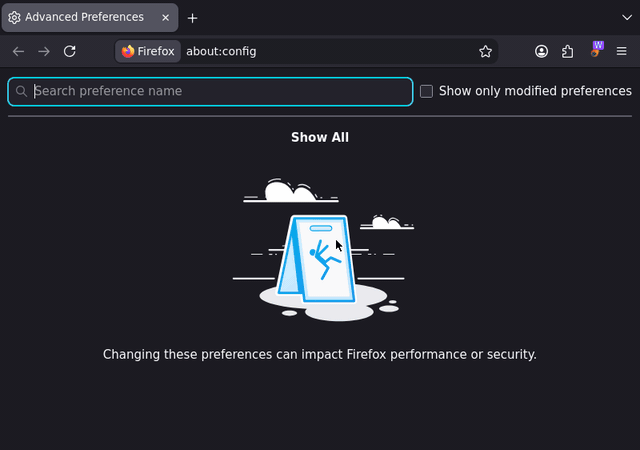

# Anubis Fast

Solve [Anubis](https://github.com/TecharoHQ/anubis) proof-of-work challenge pages instantly — including when the page's own JavaScript is disabled or blocked entirely.

<p align="left">
  
</p>

---

## Compatibility

Anubis' own challenge page normally has to run *its* JavaScript in your tab to solve the proof-of-work and unlock the site. Anubis Fast doesn't rely on that page script at all — detection and solving happen in the extension's own privileged content/background scripts, which run independently of whatever the page is (or isn't) allowed to execute. That means Anubis Fast keeps working even when you run with page JavaScript aggressively locked down:

- [**NoScript**](https://addons.mozilla.org/en-US/firefox/addon/noscript/) — whitelist-only script blocking. Anubis' challenge JS never has to be trusted.
- [**uBlock Origin**](https://addons.mozilla.org/en-US/firefox/addon/ublock-origin/) — with its per-site "block JavaScript" toggle on. Extension content scripts aren't subject to that toggle, so solving still works.
- [**AdNauseam**](https://addons.mozilla.org/en-US/firefox/addon/adnauseam/) — same story, since it builds on uBlock Origin's blocking engine.

In other words: you can keep JavaScript off for the sites Anubis fronts and still get through the checkpoint.

## Demo

<details>
<summary>Solving a challenge with page JavaScript disabled</summary>



Page JavaScript is off (`javascript.enabled` is `false` in `about:config`), so Anubis' own challenge script never runs. Anubis Fast's content script takes over the challenge page, the WASM solver finds the answer, and the site loads. The site is a local page behind a real Anubis 1.27.0, set to difficulty 5 here so the challenge page stays up long enough to see.

</details>

<details>
<summary>Solver speed: Native vs WASM vs User-Agent spoof vs JavaScript</summary>

| Solver | Median, challenge to unlocked page | Median solve time | Notes |
| --- | --- | --- | --- |
| Native | 66 ms | not reported | Shells out to `anubis-fetch`; no browser-side hashing loop. |
| WASM | 253 ms | 201 ms | Go/WASM worker, runs entirely in-tab. |
| User-Agent spoof | not measured | not measured | Tries one non-browser User-Agent before doing proof-of-work in JavaScript. It only rewrites `https://` requests, and the test site is plain `http://`. |
| JavaScript | 1.09 s | 1.04 s | Web Crypto fallback. |

Measured with `npm run measure:solvers`: Anubis 1.27.0 with the `fast` algorithm at difficulty 4 (Anubis' default), 20 runs per solver after one warm-up run, page JavaScript off, Firefox 156 on an 8-core aarch64 Linux machine. "Challenge to unlocked page" runs from the request that gets the challenge to the request that gets the site. "Solve time" is the time Anubis Fast reports to Anubis when it submits the answer; the native host solves outside the browser, so it has none. The number of hashes a challenge needs is random, so single runs vary widely: JavaScript took anywhere from 125 ms to 7.4 s.

</details>

<details>
<summary>Switching the solver from the toolbar</summary>


</details>

---

## How it works

The content script detects a challenge at `document_start` (before Anubis'
bundled JS can run) by matching `[data-anubis-challenge]` / `#anubis_challenge`
in the DOM, or by finding the text `Anubis` on a page whose path contains
`/.within.website/` (the deny/interstitial pages). It keeps watching DOM
mutations for 30 seconds in case the challenge markup appears later.

Once a challenge is found, the extension extracts the challenge JSON, the
page's cookies, and the browser's User-Agent, then asks the background script
to solve it. The background script tries, in order:

1. **Native** — hands the challenge to the local Go native-messaging host,
   which shells out to the forked `anubis-fetch` binary and returns solved
   cookies. The content script does not reload the page itself; the
   background script installs the cookies via `browser.cookies.set` and then
   navigates the tab.
2. **WASM** — if the native host is unavailable (or the native solver mode
   isn't selected), a packaged Go/WASM solver runs in a Web Worker and
   submits Anubis' `pass-challenge` endpoint directly from the tab, so the
   browser receives the auth cookie itself.
3. **User-Agent spoof** — if WASM fails, Anubis Fast makes one retry with a
   random non-browser User-Agent. Some Anubis deployments let requests with
   non-browser User-Agents through without a proof-of-work challenge. This is
   also available as a selectable solver mode named `UA`.
4. **JavaScript** — a Web Crypto fallback used if the WASM worker and the
   one-shot User-Agent spoof both fail, or if JavaScript mode is explicitly
   selected.

The Native, WASM, and JavaScript solvers implement the same Anubis "fast" verifier: find a `nonce`
such that `hex(sha256(randomData + decimal nonce))` starts with `difficulty`
zero characters.

No challenge data or cookies leave the browser except over the local
native-messaging pipe to the native host — there is no remote telemetry.

## Solver mode toggle

Click the toolbar icon to cycle the active solver backend: **N**ative → **W**asm
→ **UA** spoof → **JS** → back to Native. The badge shows the current mode and
color, and the choice persists in `browser.storage.local`. If native mode is
selected but the host disconnects mid-request, pending requests automatically
retry with the browser solver. The browser fallback tries WASM, then one UA
spoof, then JavaScript.

## Logging

- The content script logs to the protected page's own DevTools console.
- The background script logs to Firefox's Browser Console (`Ctrl+Shift+J`)
  and also fires a "Anubis Fast loaded" desktop notification each time it
  starts, as a visible signal that a reload picked up new code during
  development.
- The native host logs to stderr; see `anubis-fast-host.log` /
  `anubis-fast-host.out` conventions if you redirect it, or run it under
  `about:debugging` and check the connected terminal.

## Provider architecture

The browser code does not know how Anubis solves its challenge. A provider
registry separates detection/page-handling from the protocol used by a
specific challenge family:

- `extension/providers/anubis.js` — DOM detection and challenge extraction.
- `native/providers/anubis.go` — native-side dispatch to `anubis-fetch`.

Add a provider under both directories to support another challenge family
(e.g. Cloudflare) without touching the Anubis-specific code.

## Layout

```text
extension/                Firefox WebExtension (manifest v2)
extension/providers/      per-challenge-family DOM detection
extension/solvers/        WASM worker, WASM binary, and JS fallback solver
wasm/                     first-party Go/WASM solver source
native/                   Go native-messaging host
native/providers/         provider dispatch and PoW adapters
scripts/                  build helpers (WASM compile), README captures, solver timing
tests/live/               live Firefox tests against a real Anubis
product-page/             README GIFs and stills (generated)
```

## Permissions

| Permission | Why |
| --- | --- |
| `nativeMessaging` | talk to `anubis-fast-host` over stdio |
| `cookies` | read the page's existing cookies and install the solved auth cookie |
| `tabs` | navigate the tab once a challenge is solved |
| `storage` | persist the selected solver mode |
| `notifications` | the "extension (re)loaded" development signal above |
| `<all_urls>` | Anubis can front any site; detection must run everywhere |

The manifest also declares the `websiteActivity` and `websiteContent` data
collection categories because the extension reads challenge pages, URLs, and
cookies locally and may pass those values to the locally installed native
helper. Nothing is sent to a remote service.

---

# Contribution

## Build

Build the extension bundle (compiles the WASM solver, then packages with
TypeScript and `web-ext`):

```sh
npm install
npm run build:firefox       # -> dist/anubis_fast-<version>.zip
npm run build:firefox:xpi   # also copies the zip to dist/anubis_fast-<version>.xpi
```

The extension source lives in TypeScript under `extension/`. `npm run typecheck`
uses strict compiler settings and is the check-in gate.

With [devenv](https://devenv.sh/) installed, enter the project environment with
`devenv shell`. It provides Node, Go, and `web-ext`, and installs the TypeScript
pre-commit check through devenv's git-hook integration.

Build the native host with the Go toolchain used by `../anubis-fetch`:

```sh
go build -o anubis-fast-host ./native
```

The host finds `anubis-fetch` in this order:

1. `ANUBIS_FETCH_BIN`
2. `../anubis-fetch/result/bin/anubis-fetch` (relative to the host binary or
   the current working directory)
3. `anubis-fetch` on `PATH`

The upstream `anubis-fetch` project must be built first if none of those
resolve.

## Nix installation

The flake packages the native host and pins the fork of `anubis-fetch` into
the wrapper environment. The Home Manager module also writes Firefox's
native-messaging manifest.

In a Home Manager import:

```nix
inputs.anubis-fast.homeModules.default

programs.anubis-fast.enable = true;
# programs.anubis-fast.extensionId = "anubis-fast@mikenrafter"; # default
```

## Install for Firefox development

Register the native host for the Firefox profile in use:

```sh
./install-native-host.sh
```

This requires an executable `anubis-fast-host` on `PATH` and writes its exact
resolved path to `~/.mozilla/native-messaging-hosts/anubis_fast.json`. The
installer does not build or copy the host. By default the manifest only accepts
requests from extension ID `anubis-fast@mikenrafter`, matching
`extension/manifest.json`'s `browser_specific_settings.gecko.id`. Set
`ANUBIS_FAST_EXTENSION_ID` before running the installer if you're loading the
extension under a different ID.

Then open `about:debugging#/runtime/this-firefox`, choose **Load Temporary
Add-on**, and select `dist/anubis_fast-<version>.xpi` or
`extension/manifest.json` directly. Temporary add-ons are removed when
Firefox restarts, so re-load after every restart during development.

For the local `slaughter.pro` stack, start the site from its checkout
(`nix develop -c podman-compose up --build`, see `../slaughter.pro/ANUBIS.md`)
and open `http://localhost:8080/` through the Anubis front door.

## Tests

```sh
nix develop -c npm run typecheck   # extension, plus tests and scripts
nix develop -c npm run test:live   # real Firefox against a real Anubis
```

The live tests start a local site behind a real Anubis (from nixpkgs), then a throwaway Firefox (vanilla, from nixpkgs) on a private Xvfb display with `build/extension/` loaded as a temporary add-on. Firefox reaches the site as `http://forge.example/`. With page JavaScript turned off, they check that the challenge is solved in WASM and JavaScript mode, that the same Firefox without Anubis Fast stays stuck on the challenge, and that the toolbar button cycles the solver modes. The tests are in `tests/live/`; the harness is [firefox-addon-live](https://github.com/mikenrafter/firefox-addon-live), a flake input that `nix develop` links in as an npm dependency.

## README screenshots and GIFs

```sh
nix develop -c npm run capture:readme                # every scene
nix develop -c npm run capture:readme -- solver-mode # only some scenes
```

This rebuilds the add-on, replays each scene in a live Firefox, and writes a GIF and a PNG still per scene to `product-page/`. Scenes are in `scripts/capture-readme-assets.ts`.

The solver speed table comes from:

```sh
nix develop -c npm run measure:solvers -- --runs 20 --difficulty 4
ANUBIS_FAST_HOST=$(nix build --print-out-paths)/bin/anubis-fast-host \
  nix develop -c npm run measure:solvers -- --runs 20   # include Native
```

Native mode needs the native host. The script writes its manifest under a temporary `HOME` used only by that Firefox, so `~/.mozilla` is left alone.

---

# Slightly more technical details

## Protocol

Native Messaging frames use Firefox's standard 32-bit little-endian length
prefix followed by UTF-8 JSON. Request and response bodies are base64 encoded
so arbitrary HTML cannot corrupt the JSON frame.

Request:

```json
{"id":"...","provider":"anubis","type":"fetch","url":"https://example.test/","cookie":"anubis-auth=...; cf_clearance=..."}
```

Response:

```json
{"id":"...","ok":true,"provider":"anubis","status":200,"content_type":"text/html","body_base64":"..."}
```

On connect, the host also sends an unsolicited `{"type":"ready",...}` message
with its protocol version, executable path, and resolved `anubis-fetch`
binary path, which the background script logs but otherwise ignores.

The `provider` field is intentionally explicit. A future Cloudflare adapter
can reuse the same transport without adding Cloudflare-specific logic to the
Anubis code path.

---

## Privacy

No challenge data, cookies, or browsing activity are sent anywhere except
locally, over the native-messaging pipe to `anubis-fast-host` on the same
machine. There is no remote telemetry.

---

## Credits

The User-Agent spoof fallback is based on the approach used by
[zipdox/anubis-bypass](https://gitlab.com/zipdox/anubis-bypass/). It retries a
challenged host with a random non-browser User-Agent so Anubis deployments
that classify requests by User-Agent may pass it through.

The extension icon (`extension/icon.svg`) is composited from two icons by
[SVG Repo](https://www.svgrepo.com/):

- [Globe Alt](https://www.svgrepo.com/svg/508084/globe-alt)
- [Fireball 3](https://www.svgrepo.com/svg/478806/fireball-3)
